# ManimCE Animations

A script-oriented collection of Manim Community Edition scenes for mathematical explanations, code visualizations, and OpenGL shader experiments. Scenes are rendered directly from their Python files; the repository is not structured as a standalone application or command-line package.

## Runtime and Dependencies

- Python `>=3.13`; the captured environment uses Python 3.13.1.
- Direct Python dependencies are declared in [`pyproject.toml`](pyproject.toml): Manim CE 0.21.0 and NumPy 2.2.4.
- [`requirements.txt`](requirements.txt) is the full version-pinned package snapshot from the `CG_env` environment. It includes transitive dependencies and packaging tools for recreating that environment; it is not a hash-locked, cross-platform artifact.
- Rendering requires FFmpeg. Scenes using `Tex` or `MathTex` also require a working LaTeX toolchain. Shader scenes require an OpenGL-capable graphics environment.

Install the project environment from the repository root in PowerShell:

```powershell
py -3.13 -m venv .venv
.venv\Scripts\Activate.ps1
python -m pip install --upgrade pip
python -m pip install -e .
```

To reproduce the captured package versions instead of resolving only the declared direct dependencies:

```powershell
python -m pip install -r requirements.txt
```

The manifest intentionally declares direct imports rather than duplicating Manim's full dependency graph. When changing a direct dependency, update its pin in `pyproject.toml` and refresh the environment snapshot if exact environment reproduction is still required.

Install system prerequisites using the [Manim installation guide](https://docs.manim.community/en/stable/installation.html). Python package installation does not install FFmpeg, LaTeX, or GPU drivers.

## Rendering

Each render command names a Python file and a `Scene` subclass. The primary entry point is `ReactComponents` in `main.py`:

```powershell
manim -pqh -r "1080,1920" main.py ReactComponents
```

This renders a 1080 by 1920 portrait preview and opens it when rendering completes. Run the command from the repository root: `ReactComponents` loads `CComponent.jsx` and `FComponent.jsx` through paths relative to the current working directory.

Other scenes can be rendered the same way:

```powershell
manim -pql IEEE754.py SquareMatrix
manim -pql triangle.py TriangleInequalityLecture
```

CLI option details:

- `-p` opens the output after rendering.
- `-q l` and `-q h` select low and high quality presets; quality controls frame resolution and frame rate.
- `-r WIDTH,HEIGHT` overrides the output pixel dimensions.
- `--renderer=cairo` or `--renderer=opengl` selects the renderer for that invocation. Cairo is the default in this project; use the flag to make the choice explicit.
- `--help` lists all CLI options.

Choose a renderer per render command:

```powershell
manim --renderer=cairo -pql main.py ReactComponents
manim --renderer=opengl --write_to_movie -pql main.py ReactComponents
```

The second command requests OpenGL and explicitly enables video output. OpenGL preview alone does not write an MP4. Not every scene is compatible with both renderers: `notes/Scenes/test.py` checks for Cairo's `MovingCamera` and its `.frame`, while OpenGL uses `OpenGLCamera`.

For an OpenGL plot, `notes/plotting/plots.ipynb` includes an `OpenGLPlotExample` with unlabeled axes and a moving point. Its export cell uses `%%manim --renderer=opengl --write_to_movie -pql OpenGLPlotExample`; Manim embeds the finished MP4 in the notebook. A separate `%manim --renderer=opengl -pql OpenGLPlotExample` cell opens a live preview without saving a video. In this Manim 0.21.0 environment, numbered `Axes` labels in `Basic2DPlott` trigger an OpenGL `MathTex`/mobject-copy error; the number-free example avoids that code path. The GLSL shader experiments also require an OpenGL-capable graphics environment.

Manim writes generated media under `media/`, grouped by source file and render settings. Generated files are separate from source assets and scene scripts.

### Manim Execution Model

The CLI imports the requested module, selects its `Scene` subclass, and runs the scene lifecycle. The scene builds mobjects and schedules animations; the selected renderer evaluates the scene over time before FFmpeg encodes the rendered frames.

```mermaid
%%{init: {"theme":"base","themeVariables":{"darkMode":true,"background":"#101510","primaryColor":"#19281d","primaryTextColor":"#e8ecdf","primaryBorderColor":"#668b69","lineColor":"#8fb878","secondaryColor":"#223328","secondaryTextColor":"#e3eadc","secondaryBorderColor":"#709177","tertiaryColor":"#172019","tertiaryTextColor":"#e8ecdf","tertiaryBorderColor":"#4c6650","clusterBkg":"#121a14","clusterBorder":"#526f56","edgeLabelBackground":"#121a14","fontFamily":"Georgia, 'Times New Roman', serif"}}}%%
flowchart LR
	CLI["Manim CLI<br/>module and scene name"] --> LOAD["Import module<br/>select Scene class"]
	LOAD --> LIFE["Scene lifecycle<br/>setup() then construct()"]
	LIFE --> OBJECTS["Create and arrange<br/>Mobjects"]
	LIFE --> TIMELINE["Schedule animation<br/>play() and wait()"]
	OBJECTS --> RENDERER["Renderer<br/>Cairo or OpenGL"]
	TIMELINE --> RENDERER
	RENDERER --> FRAMES["Rendered frames"]
	FRAMES --> ENCODE["FFmpeg encoding"]
	ENCODE --> OUTPUT["Video output"]
	classDef processNode fill:#1c3021,stroke:#6d9b70,color:#e8ecdf,stroke-width:1.5px
	classDef outputNode fill:#273522,stroke:#a0b978,color:#f0eedb,stroke-width:1.5px
	class CLI,LOAD,LIFE,OBJECTS,TIMELINE,RENDERER processNode
	class FRAMES,ENCODE,OUTPUT outputNode
```



### How This Repository Uses Manim

The standard scene path renders animations to video. The shader path is different: it creates an OpenGL surface and enters Manim's interactive session instead of producing a conventional offline render.

```mermaid
%%{init: {"theme":"base","themeVariables":{"darkMode":true,"background":"#101510","primaryColor":"#19281d","primaryTextColor":"#e8ecdf","primaryBorderColor":"#668b69","lineColor":"#8fb878","secondaryColor":"#223328","secondaryTextColor":"#e3eadc","secondaryBorderColor":"#709177","tertiaryColor":"#172019","tertiaryTextColor":"#e8ecdf","tertiaryBorderColor":"#4c6650","clusterBkg":"#121a14","clusterBorder":"#526f56","edgeLabelBackground":"#121a14","fontFamily":"Georgia, 'Times New Roman', serif"}}}%%
flowchart TB
	subgraph VIDEO["Video scene path"]
		direction LR
		CMD["manim ... main.py ReactComponents"] --> SCENE["ReactComponents.construct()"]
		JSX1["CComponent.jsx"] --> CODE["customCode() creates Code mobjects"]
		JSX2["FComponent.jsx"] --> CODE
		SCENE --> RECT["Rectangle background"]
		SCENE --> CODE
		RECT --> RENDER["Scene renderer<br/>Cairo"]
		CODE --> WRITE["play(Write(...))"]
		WRITE --> RENDER
		RENDER --> VIDEOOUT["FFmpeg video<br/>media/videos/main/"]
	end
	subgraph SHADER["Interactive shader path"]
		direction LR
		SHADERCMD["manim shaders.py Shaders06"] --> SHADERSCENE["AbstractShaderScene.setup()"]
		GLSL["fragment_06.glsl"] --> SHADERSCENE
		SHADERSCENE --> QUAD["OpenGL FullScreenQuad"]
		QUAD --> EMBED["interactive_embed()<br/>interactive window"]
	end
	classDef inputNode fill:#142219,stroke:#668b69,color:#e8ecdf,stroke-width:1.5px
	classDef processNode fill:#1c3021,stroke:#6d9b70,color:#e8ecdf,stroke-width:1.5px
	classDef outputNode fill:#273522,stroke:#a0b978,color:#f0eedb,stroke-width:1.5px
	class CMD,JSX1,JSX2,SHADERCMD,GLSL inputNode
	class SCENE,CODE,RECT,WRITE,RENDER,SHADERSCENE,QUAD processNode
	class VIDEOOUT,EMBED outputNode
```



## Project Layout

- `main.py`: code-as-animation scene and primary render entry point.
- `IEEE754.py`, `sistema2x2.py`, `triangle.py`: standalone math and computer-science scenes.
- `shaders.py`, `fragment_*.glsl`, `.glsl`: interactive OpenGL shader scenes and shader sources.
- `manim_helpers/`: reusable Python helper code.
- `examples/`: smaller scene examples.
- `notes/`: reference notebooks and small scenes for animation, mobjects, plotting, and camera behavior; details below.
- `assets/`: source images, SVGs, and other scene inputs.
- `media/`: rendered output and Manim-generated media.

## Notes and Experiments

`notes/` is an exploratory area, not an installed package or automated test suite. It contains standalone `.py` scenes that Manim can render, plus `.ipynb` notebooks used to explain APIs, experiment interactively, and display saved renders.

### Animation Types

[`AnimationTypes.ipynb`](notes/animations/AnimationTypes.ipynb) compares `Transform` with copied mobjects and demonstrates the `Mobject.animate` builder for moving, scaling, and repositioning objects. It also shows the creation animations `Write`, `Create`, and `DrawBorderThenFill` on text and shapes. The companion [`test.py`](notes/animations/test.py) lays text and shapes out in a `VGroup` grid and plays those creation effects.

Render the script scene from the repository root:

```powershell
manim -pql notes/animations/test.py AnimationTest
```

### Mobject Layout

[`Mobject.ipynb`](notes/mobject/Mobject.ipynb) is a reference for `Mobject.animate`, buffer constants such as `SMALL_BUFF`, and the group layout methods `arrange` and `arrange_in_grid`. Its examples cover grid dimensions, cell alignment, row heights, column widths, and flow order. The companion [`test.py`](notes/mobject/test.py) contains `Test`, `ExampleBoxes`, and `ArrangeInGrid` scenes; the last scene demonstrates custom row and column alignment over 24 labeled rectangles.

```powershell
manim -pql notes/mobject/test.py ExampleBoxes
manim -pql notes/mobject/test.py ArrangeInGrid
```

### Plotting

[`plots.ipynb`](notes/plotting/plots.ipynb) documents `Axes` configuration and includes a logarithmic-axis example, a plotted root function, and an example that transforms a displayed equation while drawing a graph. It also has a prose reference for `get_secant_slope_group`; that API is described but is not implemented as a rendered scene in this notebook.

The plotting notebook imports `rHColor` from the repository's `code/snippets.py` and configures its Manim media output under the repository root. Select the project `.venv` kernel, run the setup and scene-definition cells, then run the `%manim -ql LogScalingExample` and `%manim -ql Basic2DPlott` cells to render and display the videos. These notebook-defined scenes cannot be passed directly to the standalone Manim CLI, which loads scenes from Python modules.

### Camera and Scene Experiments

[`notes/Scenes/test.py`](notes/Scenes/test.py) defines `MovingCameraScene` examples. `MobjectMotionAndCameraFraming` sets an initial frame height around a group of mobjects, animates their creation and movement, and uses `always_redraw` for connectors that track moving objects. `ChangingCameraWidthAndRestore` demonstrates saving the frame state, animating its width, and restoring it.

```powershell
manim -pql notes/Scenes/test.py MobjectMotionAndCameraFraming
manim -pql notes/Scenes/test.py ChangingCameraWidthAndRestore
```

### Running the Notes

Run the commands above from the repository root so relative paths resolve consistently. Select `.venv` as the Jupyter kernel before executing notebook cells. Manim's CLI loads Python modules and `Scene` subclasses; notebooks must be run as notebooks or their scene classes must be moved into a `.py` module before using the CLI.

The notebooks are historical working material, not currently verified against the project environment. Some saved outputs and image links refer to Manim CE 0.16-era render folders or absolute paths in older external workspaces. Update those references when needed and rerun the cells to verify results under the manifest's Manim CE 0.21.0 environment.

Shader scenes use Manim's OpenGL renderer and call `interactive_embed()`, so they are interactive experiments rather than ordinary offline video renders. Shader source paths are resolved relative to the current working directory, as with the code-rendering scene.
